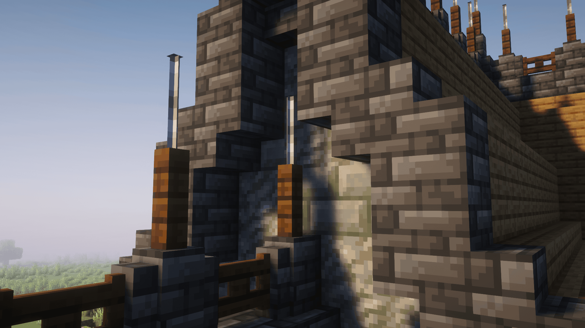
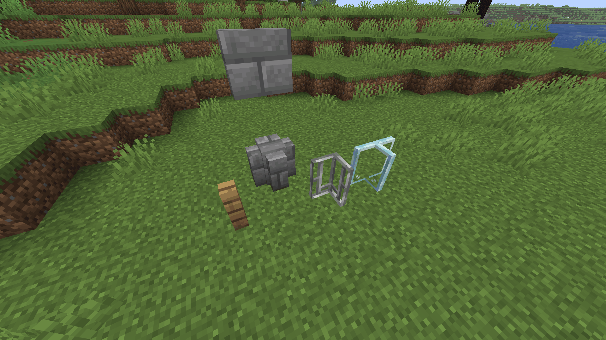

# Detached



**Take control of your fences, walls, and bars!**

Detached lets you manually connect and disconnect individual sides of fences, walls, iron bars, 
and any other blocks with similar properties.

Ever wanted a fence or wall to not connect to a neighboring block? Well, look no further!

## Features
- **Toggle individual connections:** Disconnect or force connections on individual sides of connected blocks.
- **Customize walls:** Hide or show the center post of walls.
- **Persistent changes:** Custom connections are saved, so they won't reset when you reload your world.
- **Vanilla-friendly:** Works with existing blocks rather than introducing new variants.



## How To use
1. Hold the appropriate tool for the block (axe or pickaxe)
2. Sneak and right-click the side you want to detach

For walls, you can also sneak and right-click the top of the center post to toggle its visibility.

## Installation
Detached technically only needs to be installed on the server.<br>
However, installing it on the client is also recommended, as it is necessary for the interaction animation when modifying blocks.

## Adding Other Blocks
Want to make blocks from other mods compatible with Detached? You can add them using the block tag files:
- detachable_by_axe.json
- detachable_by_pickaxe.json

These files determine which blocks can be modified and which tool is required to modify them.
<br> Tags must be in the directory: `.../data/detached/tags/block/`

**detachable_by_axe.json:**
```json
{
  "replace": false,
  "values": [
    "examplemod:example_block"
  ]
}
```

**detachable_by_pickaxe.json:**
```json
{
  "replace": false,
  "values": [
    "examplemod:another_block"
  ]
}
```

<br>

⚠️ **Important:** Adding a block to either tag does not automatically make it compatible with Detached. 
The block must have all four horizontal connection properties, matching one of the following:
- **Fence-style**: NORTH, EAST, SOUTH, and WEST (boolean properties)
- **Wall-style**: NORTH_WALL, EAST_WALL, SOUTH_WALL, and WEST_WALL (WallSide properties).

If a block does not have all four properties of at least one of these types, it will not be supported.